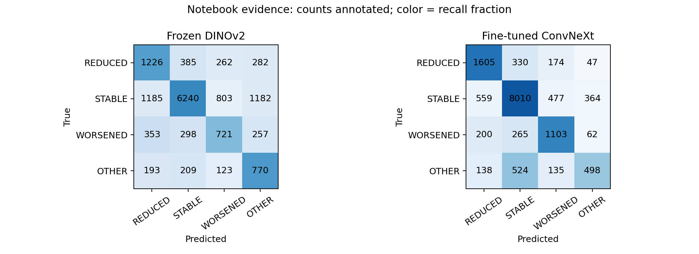

# ConvNeXt Task 1: preliminary notebook evidence

These results were recovered from saved notebook outputs. No model was run. They are exploratory cross-validation results, not an independent test benchmark.

| Model | Rows | Micro-F1 / accuracy | MCC | Macro-F1 | OTHER recall |
|---|---:|---:|---:|---:|---:|
| Frozen DINOv2 | 14489 | 0.6182 | 0.3976 | 0.5121 | 59.5% |
| Fine-tuned ConvNeXt | 14491 | 0.7740 | 0.5860 | 0.6549 | 38.5% |
| ConvNeXt embeddings + retrained heads | unverified | 0.7774 | 0.5903 | unavailable | unavailable |

## Observed failure modes

- ConvNeXt predicts STABLE for 524 of 1,295 OTHER cases (40.5%). OTHER recall is 38.5%, versus 59.5% with frozen DINOv2.
- STABLE accounts for 64.9% of the ConvNeXt cohort. Its recall is 85.1%; balanced accuracy across classes is 66.4%.
- ConvNeXt confuses REDUCED with WORSENED in 174 cases and WORSENED with REDUCED in 200 cases.
- Retraining heads adds approximately 0.0043 MCC. Significance cannot be assessed without matched case predictions.

These observations motivate a nonlinear comparison head and a separate OTHER gate. They do not establish that either architecture will improve performance.
OTHER combines uninterpretable scans and mixed changes; it is not a pure quality label. [Official Task 1 definitions](https://youvenz.github.io/MARIO_challenge.github.io/docs/compose/task1/)

## Evidence and limits

Notebook SHA-256: `06d75c185a704503b5c78619e8570fe0c110e007e8bb1f750723d92eb173e683`.

Confusion matrices were transcribed from cell 27's embedded figures and reproduce the saved row counts, accuracy and MCC. The retrained-head summary comes from cell 29.

- no raw OOF predictions, patient splits, checkpoints or histories in this checkout.
- different cohorts: DINOv2 14489 vs ConvNeXt 14491 cases.
- best epochs were selected using the folds supplying the reported scores.
- no paired inference, uncertainty, individual examples or causal architecture conclusions.

The current trainer uses validation-fold MCC for epoch selection and then reports that fold. The new study separates inner selection and fresh refit from outer evaluation.
Confidence intervals on saved OOF predictions would condition on the trained models and would not remove this selection bias. [Cross-validation uncertainty](https://arxiv.org/abs/2104.00673)

The Task 1 composite is 0.5 × micro-F1 + 0.25 × MCC + 0.25 × specificity. Published leaderboard results use different cohorts and are contextual only. [Challenge paper](https://arxiv.org/html/2506.02976v1)

Awaiting artifacts: paired patient bootstrap, calibration, patient error concentration, metadata slices, and learning-curve analysis.

